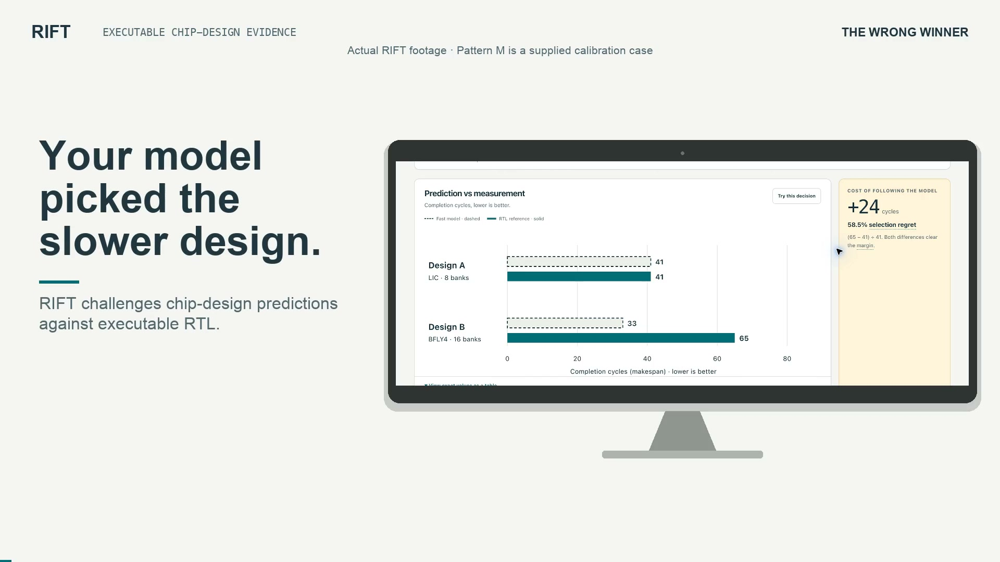

# RIFT

RIFT checks whether a fast hardware performance model chooses the right design.

In the main case, the model recommends a butterfly interconnect at 33 cycles over a crossbar at 41. The RTL finishes in 65 and 41 cycles respectively. Following the model costs 24 extra cycles, or 58.5%. RIFT traces the mistake to a shared internal link, reduces the workload, tests a structural model repair, and lets you rerun the experiment in your browser.

[Open RIFT](https://rift-hxp.pages.dev) · [Watch the 4:32 demo](https://www.dropbox.com/scl/fo/5l4ca0nivyy4rd4boenux/AEcvAlzMZrWqxId7rNGwsyE/RIFT-executable-evidence.mp4?rlkey=bd7w75brrls70ay2qdravqq9c&dl=0) · [Recorded results](docs/results.md) · [Reproduce the experiments](docs/reproduction.md)

[](https://www.dropbox.com/scl/fo/5l4ca0nivyy4rd4boenux/AEcvAlzMZrWqxId7rNGwsyE/RIFT-executable-evidence.mp4?rlkey=bd7w75brrls70ay2qdravqq9c&dl=0)

## Try the experiment

Open the live site and choose “Can you change the winner?”, then “Spread the same traffic” and Run.

The experiment keeps all 256 reads, their addresses, and each stream's operation order. It changes which initiator carries each complete stream. That changes how the butterfly's internal routes are shared.

| Same work, different initiator assignment | Crossbar RTL | Butterfly RTL | Original butterfly model | Repaired model |
|---|---:|---:|---:|---:|
| Original Pattern M | 41 cycles | 65 cycles | 33 cycles | 65 cycles |
| Streams reassigned | 41 cycles | 33 cycles | 33 cycles | 33 cycles |

The actual winner changes. The original model misses the distinction; the repaired model captures it. Every number in the live result comes from the current execution.

Pattern M is supplied calibration, so it earns no discovery credit. The separately discovered C1 witness and the search comparison are available in the case selector and Evidence stage.

## What is being compared

The reference is pinned [PULP `tcdm_interconnect` RTL](https://github.com/pulp-platform/cluster_interconnect/tree/2967d8d17be0a6139229ca8d3d4956e182aec3de/rtl/tcdm_interconnect), executed through Verilator.

| | Architecture A | Architecture B |
|---|---|---|
| Topology | Full crossbar, LIC | Radix-4 butterfly |
| Initiators | 8 | 8 |
| Memory banks | 8 | 16 |
| Total logical memory | 16 KiB | 16 KiB |
| Configuration | `lic8x8` | `bfly4_8x16` |

Both designs execute the same logical read program, each obeying its own backpressure. The measured cost is the inclusive number of cycles from first release through last response. This is a simulation of request transport and deterministic reads. There is no claim about physical clock frequency, area, energy, or fabricated silicon.

The audited bank-only model omits internal route contention. Two requests can target different banks while competing for the same butterfly router output. Qualified diagnostic traces observe that contention in 59 of 65 cycles for Pattern M.

## The investigation

The interface follows five stages. Each view links to the evidence needed to inspect its claims.

| Stage | What you can inspect |
|---|---|
| Decision | Recorded races, predicted versus measured cycles, selection regret, exact decision rules, and a 289-workload decision map |
| Workload | Eight initiator programs, stable read identities, address-to-bank mapping, topology routes, and reduced witnesses |
| Difference | Timing grids, waiting and accepted requests, measured first-stage contention, and the omitted resource |
| Repair | The model specification diff, candidate identity, development results, six acceptance gates, and held-out family results |
| Evidence | Source/toolchain identities, raw artifacts, search curves, runtime benchmarks, harness checks, formal results, and reproduction commands |

Playback supports scrubbing, stepping, speed changes, and initiator inspection. Selecting an accepted timing cell opens and focuses the corresponding read. Exact-value tables accompany charts. Explanations and detailed contracts are available without crowding the main path.

The six executed viewer cases include strict reversals, agreement, prediction ties, and an invalid-reference control. A separate set of illustrative specimens is labelled as example data and never counted as experimental evidence.

## Run the RTL in the browser

“Re-run in your browser” executes both RTL designs, the original harness monitors, and a browser implementation of the event-checking contract. The engine uses three WebAssembly modules compiled from the existing C++ driver, Verilator-generated models, and compiled fast-model implementation.

The replay reports event-hash agreement, checker validity, and measured cycles separately. The invalid-reference control can reproduce its published event hash exactly and still fail validation. RIFT withholds the architecture comparison in that case.

The workload lab adds:

- A guided stream-reassignment experiment with Run, Cancel, and Reset.
- Starting workloads from calibration cases, discovered witnesses, reduced witnesses, and selected map cells.
- An eight-initiator editor for repeat reads, ordered segments, and read sequences.
- Release after acceptance or response, with gaps from 0 through 64 cycles.
- Input validation for aligned addresses in 16 KiB, up to 1,024 reads per initiator and 4,096 total.
- Event-derived race playback and original/repaired model predictions.
- Downloadable experiment receipts for native reproduction.

A single ordinary Web Worker handles execution, event parsing, checking, hashing, and timeline preparation. Each execution gets fresh simulation state. Cancel terminates the Worker; job identities reject stale results. Modules and editor code load only after an explicit action. Shared memory and cross-origin isolation are unnecessary.

The browser animation uses observed boundary events. Internal router signals belong to the recorded diagnostic builds, where their correspondence to the reference was checked. Live experiments never change the frozen map, discovery credit, or repair acceptance.

## Search, reduction, and structural repair

The local pipeline searches for workloads where the model's ordering is decisively wrong, rather than treating every prediction error as equally consequential.

A strict reversal requires opposite orderings and a gap of at least `max(2 cycles, 2% of the smaller cost)` in both the model and RTL results. Ties follow a fixed selection policy and can have high regret without qualifying as strict reversals.

Six methods are compared under equal budgets: sweeps, random search, evolutionary search, a specialized bounded-SMT baseline, error-directed search, and decision-directed search. Applicable methods receive 64 RTL executions per case, including charged cache hits. The decision-directed acquisition function uses a source-informed ensemble of model variants and a fixed exploration policy. Search and repair are deterministic; they do not call an LLM.

| Recorded result | What it establishes |
|---|---|
| C1 discovery: 9 credited reversals versus at most 2 for the other methods | The acquisition strategy is useful when its variant library covers the missing mechanism |
| Pattern M reduced from 256 to 14 reads; discovered C1 witness from 95 to 19 | The failures can be made small enough to follow operation by operation |
| 25 structural repair candidates evaluated | The accepted patch came from a constrained model grammar |
| 13 development reversals reduced to zero | The selected structure resolves the development witnesses |
| Held-out reversals reduced from 3 to 0 across 96 workloads | The frozen repair passes a separate acceptance contract on two baskets |
| Map wrong picks reduced from 11 to 2 across 289 workloads | The repair improves this exploratory family while leaving visible failures |

Reduction is surrogate-complete and RTL-confirmed within a 32-execution reserve. Every candidate starts from reset. All single-edit neighbors are screened by an event-exact diagnostic surrogate, and 14 neighbors per reduced witness are rechecked on RTL. “1-minimal” is local to that procedure and edit set; it does not mean globally smallest.

The accepted patch is `shared_link [2,2]`: each initiator pair shares one link per group of four banks. Only the butterfly-side model specification is editable. The RTL, driver, evaluator, and workloads stay fixed.

A separate verifier checks six obligations: no model errors, fewer reversals, no new wrong choices where the parent was right, runtime at most 3× the parent, fresh RTL resolution of every development witness, and a legal patch boundary. The repair's measured runtime is 1.47× the parent's. Memorized witness costs, the wrong link structure, and a parametric-fit submission are rejected by the same verifier.

The [results](docs/results.md) include the methods that lost, rejected repairs, per-family results, and predictions that did not hold.

## Why the reference is worth checking

A model-auditing tool is only useful if its reference and evaluator can be trusted within a stated contract.

RIFT defines the drive/evaluate/sample order explicitly. Acceptance is sampled before the rising edge; a one-cycle registered read responds at the next sample. A single-read gate verifies `A4 → V5`. Address mapping, reset, release dependencies, response data, and makespan all have versioned definitions.

The C++ scoreboard derives expected data from the logical address, independently of the bank arrays. The Python checker recomputes validity and cost from raw events. It checks one offer, acceptance, and completion per operation, bank/row mapping, release timing, response latency/data, bank exclusivity, monitor failures, and agreement with the runner's summary.

Seven SystemVerilog monitors and seven C++ monitors cover the wrapper and driver. The LIC-only work-conservation check is inactive on butterfly configurations. The harness gate passes 21 checks, including injected faults, invalid workloads, timeouts, and corrupted events.

The LIC 2×2 formal harness contains 18 assertions, 10 assumptions, and five covers. Unrestricted k-induction proves the transport properties with an asserted strengthening invariant on arbiter LockIn state. All covers are reached, and a deliberately false property produces a counterexample. This proof does not cover the butterfly, memory contents, or performance models.

A reference epoch binds source revisions, wrapper, driver, memory oracle, sampling convention, and toolchain. Artifact manifests bind inputs to event streams and outcomes. The viewer rechecks digests and verdict arithmetic; a mismatch blocks the claim.

## Verification and measured overhead

The browser engine was qualified on all six published cases, both reduced witnesses, and every map workload across Chromium, Firefox, and WebKit:

```text
(6 published + 2 reduced + 289 map) × 2 RTL designs × 3 engines
= 1,782 exact event-stream hash comparisons
```

Additional fixtures compare Python, native C++, and WASM model semantics, malformed/corrupt event handling, exact margin boundaries, and failure precedence. The production UI suite covers cancellation, stale results, missing modules, editing, receipts, keyboard focus, touch, reduced motion, and 320/390/768/1440-pixel layouts.

Recorded release checks include 40 passing Python tests, 36 original browser regression tests after the final interaction fix, and 43 production UI checks. Two non-Chromium instrumentation checks are skipped because they require Chrome's debugging protocol; functional tests run across all three engines. Installed Safari separately ran the guided experiment.

| Browser release measurement | Result |
|---|---:|
| Added initial JavaScript | 1,646 bytes gzip |
| All simulator modules and loaders | 322,485 bytes gzip, about 315 KiB |
| WASM requests during ordinary browsing | 0 |
| Cold production Worker run | 216.9 ms |
| Five warm production Worker runs | 27.9–40.4 ms |
| Cold run under synthetic throttling | 4,754.1 ms |

These are measurements on the test Mac, not guarantees for every device. Worker timings include its load/setup/simulation/checking/timeline work and exclude the lab-interface and manifest load before Worker startup. See the [browser validation report](docs/browser-validation.md) for scope and test commands.

## Run a local copy

### Browser experience only

This path needs Node.js 20.19+ or 22.12+ and Python 3 for the static server. The checked-in public data and WASM modules are sufficient; an EDA toolchain is not needed.

```bash
git clone https://github.com/raaaaaif/RIFT.git
cd RIFT
npm --prefix ui ci
npm --prefix ui run build
python3 -m http.server 8770 --bind 127.0.0.1 --directory ui/dist
```

Open <http://127.0.0.1:8770/>. Published evidence, browser replay, and the workload lab all work from this static build.

For UI development after native setup and artifact generation, run `python3.12 -m rift serve --port 8770 --allow-run` in one terminal and `npm --prefix ui run dev` in another. Vite proxies its API requests to that native server. Use the static build above when you only want to explore the shipped browser experience.

### Native research pipeline

The recorded reference was qualified on macOS arm64 with Python 3.12, a C++17 compiler, the pinned OSS CAD Suite 2026-10-16, and `lz4` headers for diagnostic traces. The Linux archive identity is recorded, but Linux reproduction has not been exercised.

Follow [native setup](docs/setup.md), then run this in a fresh research checkout:

```bash
python3.12 -m rift fetch
python3.12 -m rift doctor
python3.12 -m rift pipeline
```

The pipeline runs the harness gates, calibration, formal checks, benchmark, search, repair, held-out verification, rejected controls, reduction, map, diagnostics, static publication, and evidence export. The recorded run took 346.4 seconds on an Apple M1. Resumption reuses finished stages only within the same reference epoch.

The pipeline creates fresh run directories but regenerates the case registry and public presentation data. Keep a separate checkout if you want to retain the shipped presentation byte for byte. Large scratch run stores, tool installations, and some bulky evidence copies are intentionally outside Git; their manifests and regeneration path are retained.

After generating native artifacts:

```bash
python3.12 -m rift serve --port 8770 --allow-run
```

The native server adds budgeted local replay. Public browser execution remains available without it.

### Verify a browser receipt

Download a receipt from the live experiment, then use the matching checkout and qualified native builds:

```bash
python3.12 -m rift browser-verify --receipt /path/to/rift-receipt.json
```

The verifier accepts bounded workloads and known model/configuration identities. Receipt contents cannot choose executables or output paths. It preserves run IDs for raw-event comparison, runs the original Python checker, and writes a separate verification report. Timing telemetry is excluded from semantic comparison. This release's exact native identity is qualified for macOS arm64.

### Rebuild the WASM modules

The browser toolchain has its own lock. With the native setup ready:

```bash
python3.12 scripts/install_browser_sdk.py
python3.12 -m rift.browser_build
python3.12 -m rift.browser_data
python3.12 -m rift publish
npm --prefix ui run build
```

The pinned installer needs at least 3.7 GB free. [Browser build documentation](docs/browser-execution.md) explains runtime adaptations, content-addressed assets, manifests, and integrity checks. Ordinary UI builds reuse the shipped modules.

## Tests

GitHub Actions checks the workload/verdict/receipt boundaries and builds the static UI on every push. The full native research qualification remains a separate suite.

The static browser lab can be tested without the native toolchain. Its Chromium project uses installed Google Chrome:

```bash
npm --prefix ui ci
npm --prefix ui run build
cd ui
npx playwright test -c playwright.lab.config.ts --project=chromium
```

For Firefox and WebKit, install those Playwright engines and omit the project selector. The native suite and original server-based UI suite require the native toolchain; generate the research artifacts first for recorded-artifact coverage:

```bash
python3.12 -m unittest discover -s tests -t .
PYTHONPATH=. python3.12 scripts/browser_fixtures.py
cd ui
npx playwright test
npx playwright test -c playwright.browser.config.ts
npx playwright test -c playwright.lab.config.ts
```

## Limits that matter

All six discovery-screen cases were authored for this investigation. There is no independently authored hidden case, external production regression, or second subsystem family.

Decision-directed search wins C1 and narrowly C5. Evolutionary search wins C2, C4, and C6. No method finds a strict reversal for C3. The source-informed variant library helps explain those outcomes.

The repair's held-out result is narrow: only three of 96 workloads were parent reversals. Five of eight families mainly test regressions, and one family's mean regret gets slightly worse. Basket v2 was defined after v1's result, with the candidate frozen beforehand. The 289-workload map is separate from acceptance and still contains two repaired-model reversals.

The 5× model-speed target was not met. Compiled models achieved 1.66–2.32× useful-loop speedup over batched Verilator; the higher 2.4–8.1× kernel figures exclude startup and parsing. Pure-Python models were slower than batched RTL.

Formal coverage is the specified LIC 2×2 transport harness. Workloads are bounded, read-only programs. There has been no human comprehension study, full accessibility audit, or physical low-end-device study. See [limitations](docs/limitations.md) for the complete scope.

## Code map

| Path | Responsibility |
|---|---|
| `rtl_wrapper/`, `oracle/` | SV monitors, C++ RTL driver, memory oracle, compiled models |
| `rift/contracts/`, `rift/evaluate/` | Input semantics, raw-event checker, decision rule, repair verifier |
| `rift/model/`, `models/` | Model implementations and permitted specifications |
| `rift/search/`, `rift/reduce/`, `rift/repair/` | Discovery, witness reduction, structural repair |
| `formal/` | LIC proof harness and bounded-SMT conflict search |
| `configs/`, `locks/`, `experiments/` | Architecture, source/toolchain, and experiment definitions |
| `evidence/` | Recorded reports, selected run copies, and bundle manifests |
| `ui/src/components/` | Five-stage investigation and visualization |
| `ui/src/browser/` | Worker engine, checker, editor, receipts, and live race |
| `ui/public/data/`, `ui/public/browser/` | Shipped evidence views and qualified browser runtime |
| `tests/`, `ui/*tests/` | Native, engine-parity, and browser interaction tests |
| `docs/` | Contracts, results, engineering decisions, setup, and validation |

The public repository is a release snapshot of the implemented project. Planning handoffs, local development history, private outreach material, and video-production intermediates are outside this snapshot. The recorded scientific artifacts and runtime identities are preserved.

## Attribution

The crossbar and butterfly RTL come from PULP, with `common_cells` pinned separately. RIFT supplies the audit infrastructure, contracts, harness, models, search/reduction/repair workflow, independent checking, and public investigation interface around those sources.

[Third-party notices](THIRD_PARTY_NOTICES.md) identify the upstream components and included license texts. No project-wide open-source license has been selected for RIFT's original code; the public repository makes the implementation available for review. Third-party components retain their own licenses.
